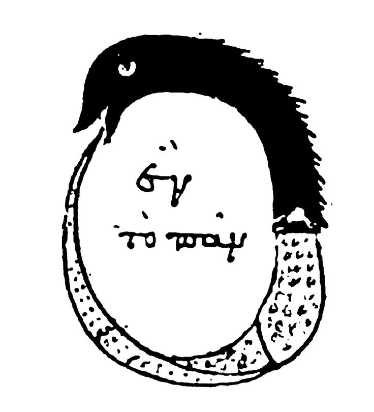
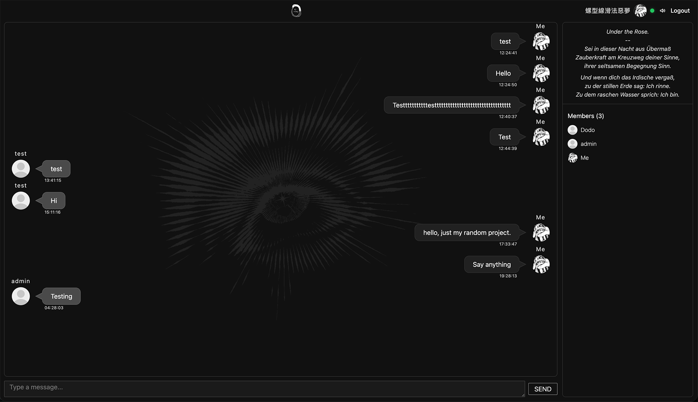

# ChatRoom



https://ouroboros-cr.duckdns.org/
一個即時多人聊天室專案，採用 Spring Boot + React，支援房間聊天、會員管理、WebSocket 即時推播、頭像上傳、系統事件訊息與通知音效。



## 專案功能

- 使用者註冊 / 登入 / 登出（Session）
- 建立聊天室、進入聊天室、離開聊天室
- 房間成員列表即時更新
- 即時聊天（WebSocket + STOMP）
- 支援多行輸入訊息與換行顯示
- 支援訊息通知音效與靜音切換
- 頭像上傳與顯示

## 技術堆疊

### Backend
- Java 21
- Spring Boot
- Spring Web MVC
- Spring Security
- Spring Data JPA
- Spring WebSocket (STOMP + SockJS)
- PostgreSQL

### Frontend
- React
- Vite
- React Router
- `@stomp/stompjs`
- `sockjs-client`

## 系統架構（簡述）

1. 前端透過 REST API 完成登入、房間操作、歷史訊息查詢。
2. 進入聊天室後，前端建立 WebSocket 連線到 `/ws`。
3. 聊天訊息送到 `/app/chat.send`，由後端廣播到 `/topic/rooms/{roomId}`。
4. 成員進出事件廣播到 `/topic/rooms/{roomId}/members`，前端更新成員與系統提示。

## 專案結構

```text
ChatRoom/
├── README.md
├── ChatRoomPlan.txt
├── chatroom/                        # Spring Boot backend
│   ├── pom.xml
│   ├── src/main/java/com/otto/chatroom/
│   │   ├── controller/              # REST + WebSocket 入口
│   │   ├── service/                 # 商業邏輯
│   │   ├── repository/              # JPA 資料存取
│   │   ├── model/                   # DTO / Entity
│   │   ├── config/                  # WebSocket / App 設定
│   │   └── security/                # 認證與安全設定
│   ├── src/main/resources/
│   │   ├── application.yml
│   │   └── static/
│   └── API_DOC.md
└── chatroom-frontend/               # React frontend
		├── package.json
		├── src/
		│   ├── pages/                   # Login / Register / RoomList / Chat
		│   ├── lib/api.js               # 前端 API 封裝
		│   └── assets/                  # 圖片與音效資源
		└── public/
```

## 快速開始

## 1. 前置需求

- Java 21+
- Maven 3.9+
- Node.js 20+
- PostgreSQL

## 2. 建立資料庫

先在 PostgreSQL 建立資料庫，例如：

```sql
CREATE DATABASE chatroom_db;
```

依你的環境修改 `chatroom/src/main/resources/application.yml` 的資料庫連線設定。

## 3. 啟動 Backend

```bash
cd chatroom
mvn spring-boot:run
```

預設服務會跑在 `http://localhost:8080`。

## 4. 啟動 Frontend

```bash
cd chatroom-frontend
npm install
npm run dev
```

預設會在 `http://localhost:5173`。

## API 與通訊路由

- REST API 文件：`chatroom/API_DOC.md`
- WebSocket 端點：`/ws`
- STOMP Send：`/app/chat.send`
- STOMP Subscribe：
	- `/topic/rooms/{roomId}`
	- `/topic/rooms/{roomId}/members`

## 開發備註

- 聊天輸入框支援多行，送出快捷鍵為 `Ctrl+Enter`（macOS 也支援 `Cmd+Enter`）。
- 通知音效可在聊天室 Header 使用圖示按鈕切換靜音。

## License

可依需求補上授權（例如 MIT）。